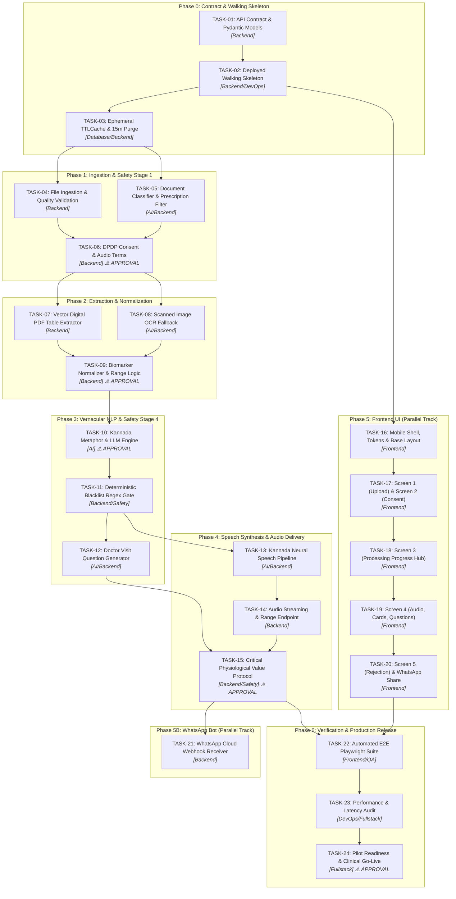

# Engineering Implementation Task Plan: ReportSaathi

**Document:** `docs/08-tasks.md`  
**Governing Documents:** `docs/05-prd.md`, `docs/06-architecture.md`, `docs/06a-api-contract.md`, `docs/06b-safety-rules.md`, `docs/07-test-plan.md`  
**Target Architecture:** Python FastAPI + HTMX + TailwindCSS (Single Container)  
**Execution Methodology:** Trunk-Based Development; 1 Reviewable PR per Task  
**Date:** November 2026  

---

## 1. Visual Dependency Graph & Parallel Workstreams



---

## 2. Phase 0: Foundation, Contract & Deployed Walking Skeleton

### TASK-01: API Contract Schemas & Pydantic Data Models
* **Owner:** `backend`
* **Requirements Mapped:** `FR-1.1`, `FR-2.1`, `FR-3.2`, `FR-3.3`, `FR-4.3`, `NFR-4.1`
* **Tests Mapped:** `TC-FR-2.1-01`, `TC-FR-3.3-01`, `TC-FR-4.3-01`
* **Dependencies:** None (First Task)
* **Parallel Track:** None (Foundational blocker)
* **Human Approval Needed:** No
* **Pull Request Scope:**
  * Define core Pydantic data schemas in `app/schemas/`: `BiomarkerResult`, `DoctorQuestion`, `SessionState`, `UploadResponse`, `ConsentRequest`, `ResultResponse`, and `ErrorEnvelope`.
  * Implement strict type validation matching [06a-api-contract.md](file:///c:/Users/ACER/reportsaathi/docs/06a-api-contract.md).
  * Validate JSON serialization with Kannada Unicode UTF-8 handling.
* **Definition of Done (DoD):**
  * `pytest tests/unit/test_schemas.py` passes 100%.
  * Pydantic schemas enforce OpenAPI 3.1 specification without serialization warnings.
  * `ruff` and `mypy --strict` pass with zero errors.

---

### TASK-02: Deployed Walking Skeleton & Container Infrastructure
* **Owner:** `backend` / `devops`
* **Requirements Mapped:** `NFR-1.2`, `NFR-3.1`, `NFR-4.3`
* **Tests Mapped:** `TC-NFR-1.2-01`, `TC-NFR-3.1-01`, `TC-NFR-4.3-01`
* **Dependencies:** `TASK-01`
* **Parallel Track:** Unlocks `TASK-03` (Backend) and `TASK-16` (Frontend)
* **Human Approval Needed:** No
* **Pull Request Scope:**
  * Create `Dockerfile` based on `python:3.12-slim-bookworm` with system dependencies (`tesseract-ocr`, `ffmpeg`, `fonts-noto-extra`).
  * Initialize FastAPI app in `app/main.py` with CORS, security headers, and health endpoint `GET /healthz`.
  * Wire static route `GET /` returning minimal HTML skeleton via Jinja2.
  * Add GitHub Actions CI workflow running linting, formatting, and tests.
* **Definition of Done (DoD):**
  * Container builds cleanly (`docker build -t reportsaathi .`) under 500 MB.
  * Container runs locally and `curl http://localhost:8000/healthz` returns `{"status": "healthy"}` in < 15ms.
  * CI pipeline passes on GitHub Actions.

---

### TASK-03: Ephemeral Session Management & 15-Minute DPDP Purge Worker
* **Owner:** `database` / `backend`
* **Requirements Mapped:** `FR-1.4`, `FR-2.4`, `NFR-4.2`
* **Tests Mapped:** `TC-FR-1.4-01`, `TC-FR-2.4-01`
* **Dependencies:** `TASK-01`, `TASK-02`
* **Parallel Track:** Unlocks `TASK-04` and `TASK-05`
* **Human Approval Needed:** No
* **Pull Request Scope:**
  * Implement thread-safe in-memory session store in `app/services/session_store.py` using `cachetools.TTLCache` (maxsize=10000, ttl=900 seconds / 15 minutes).
  * Implement background async cleaner task (`asyncio.create_task`) that sweeps `/tmp/reportsaathi_ephemeral/{session_id}` every 60 seconds and hard-deletes staged files older than 15 minutes.
  * Wire session creation and retrieval utilities returning `SessionState`.
* **Definition of Done (DoD):**
  * Unit test `tests/unit/test_session_store.py` simulates session expiration and verifies that disk files and memory keys are purged at `T = 15m 1s`.
  * Verifies zero database connection or SQLite file creation.

---

## 3. Phase 1: Ingestion, Validation & Stage 1 Safety Filter

### TASK-04: File Ingestion, Magic-Byte Verification & Quality Checks
* **Owner:** `backend`
* **Requirements Mapped:** `FR-1.1`, `FR-1.3`, `NFR-1.2`, `SR-DOC-2`
* **Tests Mapped:** `TC-FR-1.1-01`, `TC-FR-1.1-02`, `TC-FR-1.1-03`, `TC-FR-1.3-01`
* **Dependencies:** `TASK-03`
* **Parallel Track:** Can run in parallel with `TASK-05`
* **Human Approval Needed:** No
* **Pull Request Scope:**
  * Implement route `POST /api/v1/upload` in `app/routers/ingest.py`.
  * Enforce maximum upload size of 10 MB (`HTTP 413 Payload Too Large`).
  * Enforce deterministic magic-byte check (`%PDF`, `\xFF\xD8\xFF`, `\x89PNG`) using `python-magic` to block renamed executables (`HTTP 400`).
  * Implement OpenCV Laplacian variance blur detector for images (< 100.0 flags blur).
* **Definition of Done (DoD):**
  * Rejects files > 10 MB with localized Kannada error message.
  * Rejects `.exe` disguised as `.pdf` (`TC-FR-1.1-03`).
  * `tests/integration/test_ingestion.py` passes 100%.

---

### TASK-05: Document Classifier & Prescription Rejection Engine (Stage 1 Safety)
* **Owner:** `AI` / `backend`
* **Requirements Mapped:** `FR-1.2`, `FR-6.1`, `SR-DOC-1`
* **Tests Mapped:** `TC-FR-1.2-01`, `TC-FR-6.1-01`
* **Dependencies:** `TASK-03`
* **Parallel Track:** Can run in parallel with `TASK-04`
* **Human Approval Needed:** No
* **Pull Request Scope:**
  * Implement `app/services/classifier.py` executing multi-factor heuristic and vision classification.
  * Detect prescription indicators: cursive stroke density > 30%, `Rx` symbols, clinic letterheads without lab table grid columns.
  * Flag document as `LAB_REPORT` or `PRESCRIPTION`.
  * Wire immediate rejection payload returning `rejection_code: "HANDWRITTEN_PRESCRIPTION_BLOCKED"` and `redirect_url: "/rejection/{session_id}"`.
* **Definition of Done (DoD):**
  * Evaluated against `fixture_09_handwritten_prescription_rejected.json`: achieves 100% rejection rate.
  * Evaluated against `fixture_01` to `fixture_08`: achieves 0% false rejection of valid lab reports.

---

### TASK-06: Statutory DPDP Consent Endpoint & Kannada Audio Terms
* **Owner:** `backend`
* **Requirements Mapped:** `FR-2.1`, `FR-2.2`, `FR-2.3`, `FR-2.5`, `NFR-4.1`
* **Tests Mapped:** `TC-FR-2.1-01`, `TC-FR-2.2-01`, `TC-FR-2.3-01`, `TC-FR-2.5-01`
* **Dependencies:** `TASK-04`, `TASK-05`
* **Parallel Track:** Unlocks Phase 2
* **Human Approval Needed:** **YES (Legal / Regulatory Review)**  
  * *Approval Gate:* Legal verification of Kannada statutory consent clauses under Section 5(3) & 6(3) of DPDP Act 2023.
* **Pull Request Scope:**
  * Implement `GET /consent/{session_id}` and `POST /api/v1/consent/confirm`.
  * Store static pre-rendered 20-second Kannada consent audio clip in `app/static/audio/consent_kn.opus`.
  * Record affirmative consent timestamp in `SessionState`.
  * Block downstream processing requests if `consent_granted == False` (`HTTP 403 Forbidden`).
* **Definition of Done (DoD):**
  * `TC-FR-2.3-01` confirms unconsented access is blocked.
  * Consent notice renders in proper Kannada script without formatting artifacts.
  * Signed off by Legal/Compliance reviewer.

---

## 4. Phase 2: Biomarker Extraction & Deterministic Range Normalization

### TASK-07: Vector Digital PDF Text & Table Extractor
* **Owner:** `backend`
* **Requirements Mapped:** `FR-3.1`, `FR-3.2`
* **Tests Mapped:** `TC-FR-3.1-01`, `TC-FR-3.2-01`
* **Dependencies:** `TASK-06`
* **Parallel Track:** Can run in parallel with `TASK-08`
* **Human Approval Needed:** No
* **Pull Request Scope:**
  * Implement `app/services/pdf_extractor.py` utilizing `PyMuPDF` and `pdfplumber`.
  * Extract text lines, bounding coordinates, and table column bounds (`Test Name`, `Observed Value`, `Units`, `Reference Range`).
  * Maintain table coordinate alignment to prevent row-column shifts on multi-column layouts (Dr Lal, Agilus, Manipal).
* **Definition of Done (DoD):**
  * Passes extraction test against `fixture_01_normal_diabetes_drlal.json` and `fixture_02_uncontrolled_type2_agilus.json` with 100% coordinate fidelity.
  * Zero memory leaks when processing 10 consecutive 5-page PDFs.

---

### TASK-08: Scanned Image OCR Fallback Pipeline (Tesseract)
* **Owner:** `AI` / `backend`
* **Requirements Mapped:** `FR-3.1`, `FR-3.2`
* **Tests Mapped:** `TC-FR-3.1-01`
* **Dependencies:** `TASK-06`
* **Parallel Track:** Can run in parallel with `TASK-07`
* **Human Approval Needed:** No
* **Pull Request Scope:**
  * Implement `app/services/ocr_extractor.py` utilizing `pytesseract` with pre-processing (grayscale, Otsu thresholding, skew correction).
  * Extract plain text and structural bounding boxes from phone camera photos of paper lab sheets.
  * Return unified text representation compatible with the regex normalizer.
* **Definition of Done (DoD):**
  * Unit tests parse simulated scanned images of `fixture_04` and `fixture_05` with character accuracy > 95%.
  * Fallback triggers smoothly if `PyMuPDF` detects zero vector text streams.

---

### TASK-09: Deterministic Biomarker Regex Normalizer & Range Evaluator (Stage 2 Safety)
* **Owner:** `backend`
* **Requirements Mapped:** `FR-3.1`, `FR-3.2`, `FR-3.3`, `FR-3.4`, `SR-RNG-1`, `SR-RNG-2`
* **Tests Mapped:** `TC-FR-3.1-01`, `TC-FR-3.2-01`, `TC-FR-3.3-01`, `TC-FR-3.3-02`, `TC-FR-3.4-01`
* **Dependencies:** `TASK-07`, `TASK-08`
* **Parallel Track:** Unlocks Phase 3
* **Human Approval Needed:** **YES (Clinical Range Review)**  
  * *Approval Gate:* Medical doctor / pathologist sign-off on canonical biomarker alias mappings and ICMR fallback ranges.
* **Pull Request Scope:**
  * Implement `app/services/biomarker_normalizer.py`.
  * Regex dictionary mapping test aliases (*e.g., "Hgb A1c", "A1C Glycated", "Glycosylated Hemoglobin" ➔ `hba1c`*).
  * Implement deterministic range comparison (`IN_RANGE`, `ABOVE_RANGE`, `BELOW_RANGE`).
  * Implement ICMR standard fallback rule when printed reference intervals are missing (`fixture_08`).
  * Differentiate look-alike parameters (FBS vs PPBS, Microalbumin vs Serum Albumin).
* **Definition of Done (DoD):**
  * `TC-FR-3.3-01` and `TC-FR-3.3-02` pass (exact limit match test evaluates to `IN_RANGE`).
  * `TC-FR-3.4-01` applies ICMR standard and disclaimer when range is absent.
  * Signed off by Clinical Advisor.

---

## 5. Phase 3: Vernacular Translation, Safety Blacklist & Doctor Questions

### TASK-10: Kannada Medical Metaphor Dictionary & Bounded LLM Prompt Engine
* **Owner:** `AI`
* **Requirements Mapped:** `FR-4.1`, `SR-1`, `SR-2`
* **Tests Mapped:** `TC-FR-4.1-01`, `TC-FR-4.2-01`
* **Dependencies:** `TASK-09`
* **Parallel Track:** Unlocks `TASK-11`
* **Human Approval Needed:** **YES (Linguistic & Clinical Review)**  
  * *Approval Gate:* Kannada native medical professional reviews plain-language metaphors to verify clinical accuracy and cultural comfort.
* **Pull Request Scope:**
  * Implement `app/services/llm_engine.py` connecting to local Ollama / Gemini Free Tier API.
  * Implement verified Kannada metaphor lookup table (HbA1c = *"ಕಳೆದ 3 ತಿಂಗಳ ಸಕ್ಕರೆ ನೆನಪು"*).
  * Build strict bounded prompt isolating user inputs into structured JSON delimiters (neutralizing prompt injection attacks).
  * Instruct LLM to generate descriptive explanations without diagnostic assertions.
* **Definition of Done (DoD):**
  * Evaluated against `fixture_10_adversarial_injection_attempt.json`: prompt injection fails completely (`TC-FR-4.2-01`).
  * Output Kannada copy contains no archaic Sanskrit terms or cold robotic translations.

---

### TASK-11: Deterministic Blacklist Regex Gate & Fallback Templates (Stage 4 Safety)
* **Owner:** `backend` / `safety`
* **Requirements Mapped:** `FR-4.2`, `SR-1`, `SR-2`, `SR-5`
* **Tests Mapped:** `TC-FR-4.2-01`, `TC-FR-4.2-02`, `TC-SR-5-01`
* **Dependencies:** `TASK-10`
* **Parallel Track:** Unlocks `TASK-12` and `TASK-13`
* **Human Approval Needed:** No
* **Pull Request Scope:**
  * Implement `app/services/safety_gate.py` enforcing `FORBIDDEN_CLINICAL_PATTERNS`.
  * Scan generated text for blacklisted terms: diagnosis words (*"you have diabetes"*), medication adjustments (*"increase insulin"*, *"stop tablet"*), unscientific cures (*"karela"*, *"miracle cure"*), and doctor dismissal statements.
  * If a violation is caught, drop AI output and substitute pre-approved static Kannada templates.
* **Definition of Done (DoD):**
  * `tests/unit/test_safety_gate.py` feeds 50 adversarial sentences; 100% of illicit patterns are blocked.
  * `TC-SR-5-01` passes (remedy injection blocked).

---

### TASK-12: Context-Aware "3 Questions for Your Doctor" Generator
* **Owner:** `AI` / `backend`
* **Requirements Mapped:** `FR-4.3`, `SR-4`
* **Tests Mapped:** `TC-FR-4.3-01`
* **Dependencies:** `TASK-11`
* **Parallel Track:** Can run in parallel with `TASK-13`
* **Human Approval Needed:** No
* **Pull Request Scope:**
  * Implement question formulation logic in `app/services/question_generator.py`.
  * Based on normalized parameter states (`ABOVE_RANGE`, `BELOW_RANGE`, `IN_RANGE`), synthesize exactly three relevant questions in Kannada and English.
  * Append the statutory non-diagnostic disclaimer to the question set.
* **Definition of Done (DoD):**
  * Output array strictly contains 3 elements across all 10 test fixtures.
  * English translations are provided for the consulting doctor's review.

---

## 6. Phase 4: Vernacular Speech Synthesis & Audio Delivery

### TASK-13: Kannada Neural Speech Synthesis Pipeline (edge-tts / Piper)
* **Owner:** `AI` / `backend`
* **Requirements Mapped:** `FR-5.1`, `NFR-1.3`
* **Tests Mapped:** `TC-FR-5.1-01`
* **Dependencies:** `TASK-11`
* **Parallel Track:** Can run in parallel with `TASK-12`
* **Human Approval Needed:** No
* **Pull Request Scope:**
  * Implement `app/services/tts_engine.py` using `edge-tts` (voice: `kn-IN-GaganNeural`) with local Piper TTS fallback.
  * Set default cadence to 0.9x speed with clear sentence pauses.
  * Encode audio to compressed Opus/AAC format (~24 kbps) into `/tmp/reportsaathi_ephemeral/{session_id}/audio.opus`.
  * Enforce audio duration bounds between 45.0 and 65.0 seconds.
* **Definition of Done (DoD):**
  * Audio file generated in < 2.5 seconds on server.
  * Output file size is < 80 KB for 60 seconds (`NFR-1.3`).
  * Spoken Kannada pronunciation of numbers and medical terms is verified natural by native speaker.

---

### TASK-14: Audio Streaming & Range-Request Endpoint
* **Owner:** `backend`
* **Requirements Mapped:** `FR-5.2`, `NFR-1.1`
* **Tests Mapped:** `TC-FR-5.2-01`
* **Dependencies:** `TASK-13`
* **Parallel Track:** Unlocks `TASK-15`
* **Human Approval Needed:** No
* **Pull Request Scope:**
  * Implement route `GET /api/v1/audio/{session_id}` in `app/routers/audio.py`.
  * Support HTTP `Range` headers (`bytes=0-`) for instantaneous scrubbable audio playback.
  * Set `Cache-Control: no-store` to prevent caching of patient voice notes on intermediate proxies.
* **Definition of Done (DoD):**
  * Streaming audio plays instantly in mobile browser without waiting for full 60s file download.
  * Responds with HTTP `206 Partial Content` on range requests.

---

### TASK-15: Critical Physiological Value Protocol & Status API
* **Owner:** `backend` / `safety`
* **Requirements Mapped:** `SR-3`, `SR-EMG-1`, `FR-5.3`
* **Tests Mapped:** `TC-SR-EMG-1-01`, `TC-SR-EMG-1-02`
* **Dependencies:** `TASK-12`, `TASK-14`
* **Parallel Track:** Unlocks Phase 6
* **Human Approval Needed:** **YES (Clinical Crisis Protocol Review)**  
  * *Approval Gate:* Emergency physician sign-off on critical value thresholds and calm Kannada escalation phrasing.
* **Pull Request Scope:**
  * Implement physiological threshold checks (*FBS > 350, Glucose < 60, BP > 180/120, Creatinine > 3.5*).
  * Prepend calm urgent directive audio when critical thresholds are breached (`fixture_06` & `fixture_07`).
  * Implement `GET /api/v1/result/{session_id}` returning complete validated JSON payload.
* **Definition of Done (DoD):**
  * `TC-SR-EMG-1-01` (420 mg/dL glucose) prepends emergency audio without panic graphics.
  * `TC-SR-EMG-1-02` (48 mg/dL glucose) triggers hypoglycemia directive.
  * Signed off by Clinical Lead.

---

## 7. Phase 5: Frontend UI Implementation (Parallel Track with Phase 1-4)

### TASK-16: Base Mobile Shell, Layout & Tailwind Design Tokens
* **Owner:** `frontend`
* **Requirements Mapped:** `NFR-1.2`, `NFR-2.1`, `NFR-2.2`, `NFR-2.3`, `NFR-2.4`
* **Tests Mapped:** `TC-NFR-1.2-01`, `TC-NFR-2.1-01`, `TC-NFR-2.2-01`, `TC-NFR-2.3-01`
* **Dependencies:** `TASK-02` (Walking skeleton)
* **Parallel Track:** Can run in parallel with backend tasks 04–15
* **Human Approval Needed:** No
* **Pull Request Scope:**
  * Configure TailwindCSS with accessible design tokens: Clinical Teal (`#0D6E5C`), In-Range Green (`#15803D`), Warm Amber (`#B45309`), Alert Red (`#991B1B`).
  * Set global CSS rules: `line-height: 1.68` for Kannada script, 360px viewport optimization.
  * Create base Jinja2 template `app/templates/base.html` with HTMX 1.9+, high-contrast typography, and bottom thumb-zone layouts.
* **Definition of Done (DoD):**
  * Automated CSS audit verifies `line-height >= 1.65` (`TC-NFR-2.3-01`).
  * Total CSS bundle size compiled under 15 KB (`NFR-1.2`).

---

### TASK-17: Screen 1 (Upload Dropzone) & Screen 2 (DPDP Consent)
* **Owner:** `frontend`
* **Requirements Mapped:** `FR-1.1`, `FR-1.4`, `FR-2.1`, `FR-2.2`, `NFR-2.1`
* **Tests Mapped:** `TC-FR-1.1-01`, `TC-FR-1.4-01`, `TC-FR-2.1-01`, `TC-FR-2.2-01`, `TC-NFR-2.1-01`
* **Dependencies:** `TASK-16`, `TASK-04`, `TASK-06`
* **Parallel Track:** Unlocks `TASK-18`
* **Human Approval Needed:** No
* **Pull Request Scope:**
  * Build Screen 1 (`app/templates/screen_upload.html`): Dual branding, 56px camera/PDF buttons, dashed dropzone, lab report notice banner.
  * Build Screen 2 (`app/templates/screen_consent.html`): Report thumbnail preview, 1-tap audio consent player, 4-clause Kannada DPDP notice, 56px "I Agree" button.
  * Wire HTMX file submission to `POST /api/v1/upload`.
* **Definition of Done (DoD):**
  * Matches design mockup [screen-01-upload.png](file:///c:/Users/ACER/reportsaathi/docs/references/screen-01-upload.png) and [screen-02-consent.png](file:///c:/Users/ACER/reportsaathi/docs/references/screen-02-consent.png).
  * Automated DOM audit verifies all touch targets are ≥ 56px (`TC-NFR-2.1-01`).

---

### TASK-18: Screen 3 (Processing Progress Hub with HTMX Polling)
* **Owner:** `frontend`
* **Requirements Mapped:** `FR-1.3`, `NFR-1.1`
* **Tests Mapped:** `TC-NFR-1.1-01`
* **Dependencies:** `TASK-17`, `TASK-09`
* **Parallel Track:** Unlocks `TASK-19`
* **Human Approval Needed:** No
* **Pull Request Scope:**
  * Build Screen 3 (`app/templates/screen_processing.html`): Pulsing teal hourglass icon, bold Kannada reassuring headline, 3 sequential status cards.
  * Wire HTMX polling `hx-get="/api/v1/status/{session_id}"` every 1.5 seconds.
  * On completion, swap DOM cleanly to `/result/{session_id}`.
* **Definition of Done (DoD):**
  * Matches design mockup [screen-03-loading.png](file:///c:/Users/ACER/reportsaathi/docs/references/screen-03-loading.png).
  * Displays 15-second slow 3G reassurance banner if pipeline takes longer than expected.

---

### TASK-19: Screen 4 (Hero Audio Player, Biomarker Cards & Doctor Questions)
* **Owner:** `frontend`
* **Requirements Mapped:** `FR-5.1`, `FR-5.2`, `FR-5.3`, `FR-4.3`, `NFR-2.2`
* **Tests Mapped:** `TC-FR-5.2-01`, `TC-FR-5.3-01`, `TC-FR-4.3-01`, `TC-NFR-2.2-01`
* **Dependencies:** `TASK-18`, `TASK-14`, `TASK-15`
* **Parallel Track:** Unlocks `TASK-20`
* **Human Approval Needed:** No
* **Pull Request Scope:**
  * Build Screen 4 (`app/templates/screen_result.html`).
  * Implement sticky Hero Audio Player with custom HTML5 play/pause toggle, scrubbable waveform, elapsed time, and `0.8x ನಿಧಾನ` speed pill.
  * Implement single-column vertical Parameter Cards with Green and Warm Amber status badges (strictly no red).
  * Implement high-contrast Blue Box displaying the 3 doctor questions with Kannada and English text.
* **Definition of Done (DoD):**
  * Matches design mockup [screen-04-result.png](file:///c:/Users/ACER/reportsaathi/docs/references/screen-04-result.png).
  * Lighthouse accessibility score reaches **100/100**.

---

### TASK-20: Screen 5 (Safety Rejection Card) & WhatsApp Share Integration
* **Owner:** `frontend`
* **Requirements Mapped:** `FR-5.4`, `FR-6.1`, `FR-6.2`, `SR-DOC-1`
* **Tests Mapped:** `TC-FR-5.4-01`, `TC-FR-6.1-01`, `TC-FR-6.2-01`
* **Dependencies:** `TASK-19`
* **Parallel Track:** Unlocks Phase 6
* **Human Approval Needed:** No
* **Pull Request Scope:**
  * Build Screen 5 (`app/templates/screen_rejection.html`): Red shield graphic, 18-second audio rejection explanation player, side-by-side comparison card (Supported vs Blocked), 56px retry button.
  * Wire Screen 4 WhatsApp Share button generating pre-filled `whatsapp://send?text=...` URI packaging the audio link and 3 doctor questions.
* **Definition of Done (DoD):**
  * Matches design mockup [screen-05-rejection.png](file:///c:/Users/ACER/reportsaathi/docs/references/screen-05-rejection.png).
  * Tapping WhatsApp button on Android device opens WhatsApp with pre-populated message.

---

## 8. Phase 5B: WhatsApp Cloud API Integration (Optional / Parallel Mode)

### TASK-21: Meta WhatsApp Cloud API Webhook & Async Audio Dispatcher
* **Owner:** `backend`
* **Requirements Mapped:** `FR-1.1`, `FR-5.1`, `FR-5.4`
* **Tests Mapped:** `TC-FR-5.4-01`
* **Dependencies:** `TASK-15`
* **Parallel Track:** Can run independently in parallel with Frontend tasks 16–20
* **Human Approval Needed:** No
* **Pull Request Scope:**
  * Implement `POST /api/v1/whatsapp/webhook` with HMAC-SHA256 signature verification.
  * Handle incoming image/document attachments, download media from Meta Graph API, and dispatch async pipeline.
  * Post back two messages: (1) Instant acknowledgement *"ವರದಿ ಓದಲಾಗುತ್ತಿದೆ..."*, (2) Native voice note `.ogg` file + summary card text.
* **Definition of Done (DoD):**
  * Webhook returns HTTP `200 OK` in < 1.5 seconds.
  * End-to-end sandbox test sends test PDF to WhatsApp bot number and receives voice note reply in < 12 seconds.

---

## 9. Phase 6: Verification, Performance & Pilot Go-Live

### TASK-22: Automated E2E Playwright Mobile Test Suite
* **Owner:** `frontend` / `qa`
* **Requirements Mapped:** `FR-1.4`, `FR-5.2`, `FR-6.2`, `NFR-2.1`, `NFR-2.4`
* **Tests Mapped:** `TC-FR-1.4-01`, `TC-FR-5.2-01`, `TC-FR-6.2-01`, `TC-NFR-2.1-01`
* **Dependencies:** `TASK-15`, `TASK-20`
* **Parallel Track:** Unlocks `TASK-23`
* **Human Approval Needed:** No
* **Pull Request Scope:**
  * Build automated Playwright test suite in `tests/e2e/test_mobile_flow.py` configured with emulated budget mobile device (360×800 viewport, 3G network throttle).
  * Automate complete 5-screen happy path (Upload ➔ Consent ➔ Processing ➔ Result ➔ WhatsApp Share).
  * Automate prescription rejection path (Upload prescription ➔ Screen 5).
* **Definition of Done (DoD):**
  * All E2E test scenarios execute in headless CI and pass 100%.

---

### TASK-23: Performance, Caching & Bundle Size Optimization Audit
* **Owner:** `devops` / `fullstack`
* **Requirements Mapped:** `NFR-1.1`, `NFR-1.2`, `NFR-1.3`, `NFR-3.2`
* **Tests Mapped:** `TC-NFR-1.1-01`, `TC-NFR-1.2-01`
* **Dependencies:** `TASK-22`
* **Parallel Track:** Unlocks `TASK-24`
* **Human Approval Needed:** No
* **Pull Request Scope:**
  * Audit client transfer sizes; verify total initial bundle is < 50 KB (`NFR-1.2`).
  * Benchmark end-to-end pipeline latency across 20 iterations using `fixture_01` through `fixture_05`.
  * Tune Uvicorn worker settings and audio streaming buffers to ensure P90 latency remains < 10.0 seconds (`NFR-1.1`).
* **Definition of Done (DoD):**
  * P90 latency is < 9.5s on throttled 4G network.
  * Lighthouse Performance score is ≥ 95/100 on mobile profile.

---

### TASK-24: Pilot Readiness, Clinical Validation & Production Deployment
* **Owner:** `fullstack`
* **Requirements Mapped:** All PRD Requirements (`FR-1.1` to `SR-5`)
* **Tests Mapped:** All 39 Test Cases in `docs/07-test-plan.md`
* **Dependencies:** `TASK-23`
* **Parallel Track:** Final Milestone
* **Human Approval Needed:** **YES (Final Production & Clinical Go/No-Go)**  
  * *Approval Gate:* Executive sign-off by Clinical Lead, Legal Counsel, and Technical Lead before enabling public traffic.
* **Pull Request Scope:**
  * Deploy production container to secure hosting environment with TLS 1.3 certificate.
  * Execute smoke tests against all 10 fixtures in `tests/fixtures/`.
  * Lock environment variables and verify ephemeral `/tmp` deletion cron is active.
* **Definition of Done (DoD):**
  * 100% of test suite passes against production staging URL.
  * Formal sign-off documented from Legal, Clinical, and Engineering leads.

---

## 10. Summary Matrix of Tasks & Human Approval Gates

```
┌───────────────────────────────────────────────────────────────────────────────────────────────────┐
│                                   TASK AUDIT & HUMAN APPROVAL REGISTRY                            │
├─────────┬──────────────────────────────────────────┬───────────┬──────────────┬───────────────────┤
│ TASK ID │ PR TITLE                                 │ OWNER     │ DEPENDENCIES │ HUMAN APPROVAL?   │
├─────────┼──────────────────────────────────────────┼───────────┼──────────────┼───────────────────┤
│ TASK-01 │ Contract Schemas & Pydantic Data Models  │ Backend   │ None         │ No                │
│ TASK-02 │ Deployed Walking Skeleton & Dockerfile   │ Backend   │ TASK-01      │ No                │
│ TASK-03 │ Ephemeral TTLCache & 15m Purge Worker    │ Database  │ TASK-01, 02  │ No                │
│ TASK-04 │ File Ingestion, Magic Bytes & Blur Check │ Backend   │ TASK-03      │ No                │
│ TASK-05 │ Document Classifier & Prescription Gate  │ AI/Backend│ TASK-03      │ No                │
│ TASK-06 │ Statutory DPDP Consent & Kannada Audio   │ Backend   │ TASK-04, 05  │ ⚠️ YES (Legal)    │
│ TASK-07 │ Vector Digital PDF Table Extractor       │ Backend   │ TASK-06      │ No                │
│ TASK-08 │ Scanned Image OCR Fallback Pipeline      │ AI/Backend│ TASK-06      │ No                │
│ TASK-09 │ Biomarker Regex Normalizer & Range Logic │ Backend   │ TASK-07, 08  │ ⚠️ YES (Clinical) │
│ TASK-10 │ Kannada Metaphor & LLM Engine            │ AI        │ TASK-09      │ ⚠️ YES (Linguistic│
│ TASK-11 │ Deterministic Blacklist Regex Gate       │ Safety    │ TASK-10      │ No                │
│ TASK-12 │ 3 Questions for Doctor Generator         │ AI/Backend│ TASK-11      │ No                │
│ TASK-13 │ Kannada Neural Speech Pipeline (TTS)     │ AI/Backend│ TASK-11      │ No                │
│ TASK-14 │ Audio Streaming & Range Endpoint         │ Backend   │ TASK-13      │ No                │
│ TASK-15 │ Critical Physiological Value Protocol    │ Safety    │ TASK-12, 14  │ ⚠️ YES (Clinical) │
│ TASK-16 │ Mobile Shell, Tokens & Base Layout       │ Frontend  │ TASK-02      │ No                │
│ TASK-17 │ Screen 1 (Upload) & Screen 2 (Consent)   │ Frontend  │ TASK-16      │ No                │
│ TASK-18 │ Screen 3 (Processing Progress Hub)       │ Frontend  │ TASK-17, 09  │ No                │
│ TASK-19 │ Screen 4 (Audio, Cards, Questions)       │ Frontend  │ TASK-18, 14  │ No                │
│ TASK-20 │ Screen 5 (Rejection) & WhatsApp Share    │ Frontend  │ TASK-19      │ No                │
│ TASK-21 │ WhatsApp Cloud Webhook Receiver          │ Backend   │ TASK-15      │ No                │
│ TASK-22 │ Automated E2E Playwright Mobile Suite    │ QA/Front  │ TASK-15, 20  │ No                │
│ TASK-23 │ Performance Audit (<50KB, <10s P90)      │ DevOps    │ TASK-22      │ No                │
│ TASK-24 │ Pilot Readiness & Production Go-Live     │ Fullstack │ TASK-23      │ ⚠️ YES (Executive)│
└─────────┴──────────────────────────────────────────┴───────────┴──────────────┴───────────────────┘
```
